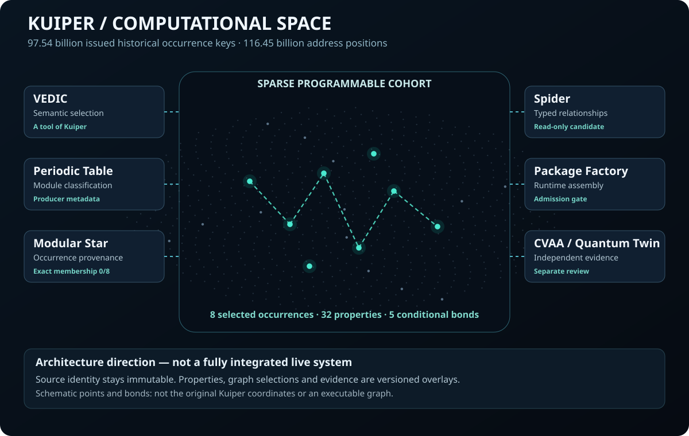
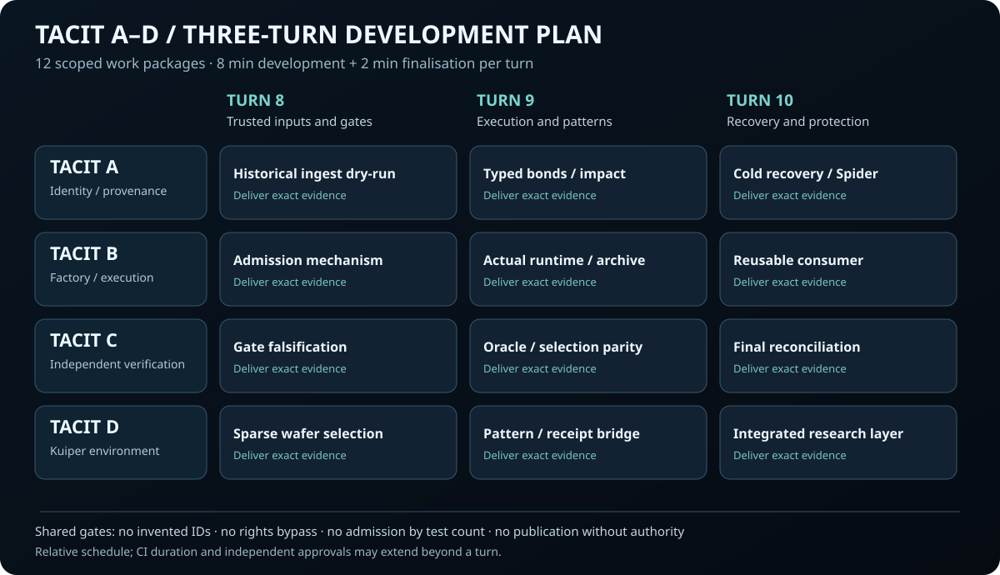

# TACIT A–D: turns 8–10

[Plain-text joint mandate](MANDATE.txt)

Both diagrams are planning illustrations, not live telemetry or proof of full integration. The mandate references observed evidence separately from scheduled work. No source redistribution or production deployment is authorised by this documentation.

## Development findings and factory decision

[Verified achievements, limitations, and decision to retain Package Factory in VEDIC](DEVELOPMENT-FINDINGS-AND-FACTORY-DECISION.md)

## Supervisor cold-session transfer

[Reload TACIT b t b a — complete project handover](TACIT-B-T-B-A-COLD-TRANSFER.txt)
