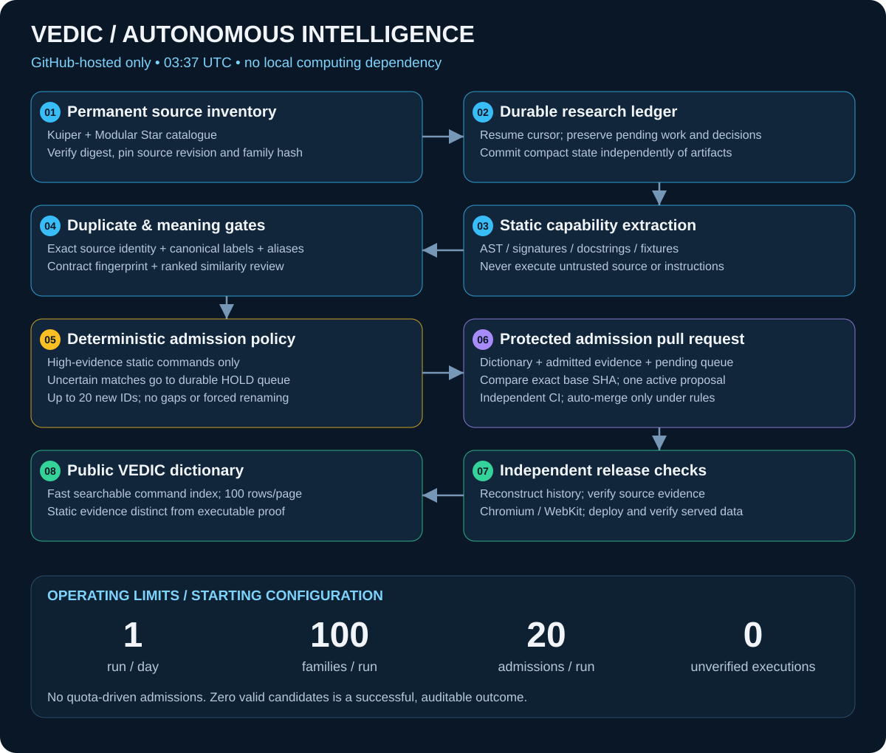
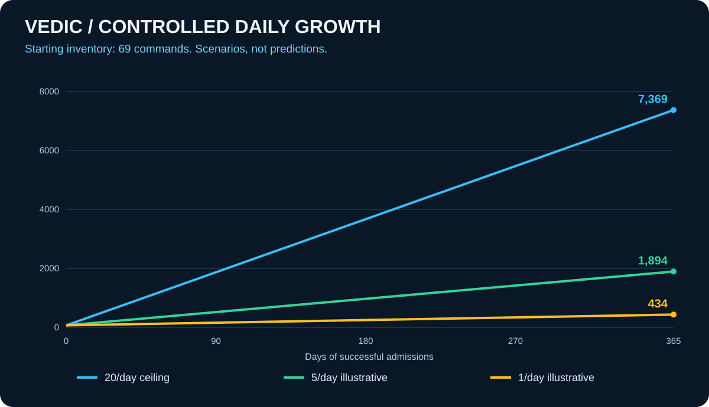

# VEDIC — autonomous GitHub intelligence
**26 November 2026 · TACIT b t b · Standalone implementation proposal for review**

**Decision requested:** Authorise one GitHub-hosted workflow to discover, deduplicate, verify and automatically admit source-backed computational commands under a predefined policy. No MSI terminals, self-hosted runners, active ChatGPT sessions, external LLM service, GPU or daily human approval shall be required for the policy-approved path. Ambiguous records may remain held indefinitely. This is a design proposal, not evidence of deployment.

## 1. Scope and starting position

The main VEDIC dictionary contained 69 entries when checked on 26 November. The previously reported Modular Star inventory was 33,221 families; fetch the actual current count at runtime. These are not one-to-one units. VEDIC is a dictionary of reusable computational operations, not a copy of the estate or a claim of executable coverage. Preserve the existing interface, permanent IDs, source pins and historic releases. Retain alphabetical search and 100-row detail pagination. Continuous prose and research processing stay outside the public interface.

Use the existing VEDIC repository (Ventusltd/vedic-), Modular Star (Ventusltd/stars), existing Kuiper identities and established Pages release process. Reuse existing tools/family_pulse.py, tools/dictionary_shards.py, tools/allocate_commands.py, tools/validate_dictionary.py, and relevant workflows. The latest PR #27 deliberately uses read-only admission artifacts; this proposal adds a new policy-governed automatic admission path only after explicit approval. Avoid competing scheduled workflows: extend the existing modular-consumer schedule or replace it atomically, never run both.

## 2. Daily execution contract

| Parameter | Initial value |
|---|---|
| Schedule | 03:37 UTC, once daily |
| Runner | GitHub-hosted Ubuntu, Python 3.12 |
| Discovery | At most 100 permanent family IDs per successful run |
| Source acquisition | At most 25 unique pinned blobs / 1 MiB per blob / 20 MiB total downloaded source |
| Admission | At most 20 new permanent commands per run; no minimum |
| Discovery timeout | 10 minutes |
| Admission and CI budgets | 5 minutes for proposal, normal existing release-check budgets; initially cap total orchestration at 30 minutes and measure before increasing |
| Parallel work | One canonical scheduled writer; bounded source reads, maximum four concurrent |
| Recovery | Durable ledger; bounded retry on transient errors; no unbounded retry loops |
| Artifacts | ZSTD Parquet and JSON, 14-day retention; state independent of artifacts |

Treat these caps as proposed engineering defaults, not quotas or guarantees of cost. Allow a manual read-only rehearsal without advancing state; manual admission dispatch must use the same protected single-writer protocol. Use existing GitHub-hosted resources and policy; no external paid semantic API. Capture actual wall time, network bytes and runner minutes. A day with zero valid new commands is successful, not a reason to relax checks.

## 3. Source discovery and durable progress

1. Resolve the producer release to a verified asset ID, byte length and SHA-256. Limit compressed/decompressed size and parse only expected schemas. Record the producer digest and pin all subsequent source reads to immutable commits/blobs. Never execute source.
2. Recover the permanent family number and hash from a dedicated research-state branch. Validate the checkpoint against the producer family registry. On missing or damaged state, distinguish genuine first run from state loss; recover a verified previous receipt or stop. Do not reset silently on artifact expiry. If a family identity changes unexpectedly, stop and report.
3. Visit the next 100 permanent IDs, including explicit no-current-placement dispositions. Do not wrap silently. On exhaustion keep the high-water mark and wait for new IDs. Use a separately versioned reconciliation pass for changed placement evidence, with its own cursor and budget; do not mix the two.
4. Persist pending source work before advancing a family cursor: every visited family must have an auditable disposition (already covered, candidate queued, held, deferred, no placement). Source-budget exhaustion puts unresolved work on a durable queue. Cursor and queue changes must be one atomic state commit.
5. Retry deferred transient failures on future scheduled cycles with bounded backoff, while retaining new-family research capacity. Process oldest eligible work first within each bounded category. Permanently unresolved records are held, not repeatedly downloaded.

## 4. Autonomous command generation

Use only deterministic static analysis. Parse supported languages with a pinned parser (Python AST and JavaScript/TypeScript tree-sitter are proposed initial adapters). Use function declarations, signatures, explicit documentation, type hints, source boundaries, existing tests and capability manifests to extract a canonical operation. Do not infer general-purpose semantics from a function name alone. Do not import or run unknown modules, shell snippets or repository-provided setup scripts to obtain a command.

Candidate output fields: compact uppercase canonical label (one to five words), concise purpose, typed or explicitly documented inputs and outputs, limitations, immutable source repo/commit/blob/path/span, family ID and hash, normalized contract fingerprint, review-policy version, source evidence references and deterministic decision receipt. Preserve the existing dictionary schema where possible; introduce a versioned machine-admission schema where necessary rather than pretending an autonomous record is a human review. Creation evidence should point to a committed review receipt, never a guessed future commit SHA.

Example label mapping, illustrative only: calculateBearing → BEARING; filterAssets → FILTER ASSETS. These names do not prove equivalence or admission eligibility. Prefer an existing canonical command when evidence establishes reuse. Do not invent variants just to add rows.

## 5. Duplicate prevention

Perform these checks against the complete published dictionary, historical admission archive and current pending candidates, not just the visible page.

| Gate | Method | Decision |
|---|---|---|
| D1 | Exact immutable source occurrence (repo, revision, blob, path, span) and normalized AST fingerprint | Duplicate source is not a new command; retain provenance where policy permits |
| D2 | NFKC normalization, casefold, separator/whitespace normalization, canonical label and aliases | Identical lexical labels block automatic creation |
| D3 | Full translation identity, sense key and scoped symbol identity | Block repeated identity; unrelated same-name symbols require resolution |
| D4 | Contract fingerprint from operation, input/output and limitations; family ID and hash | Establish equivalent reviewed capability or hold if evidence is incomplete |
| D5 | Bounded token/character similarity and deterministic nearest-neighbour ranking | Candidate for reconciliation only; similarity alone never proves equivalence |
| D6 | Shared family / overlapping source / dependency relationship | Allow distinct operations only with independently reproducible, policy-supported rationale |

Use indexed hash maps and SQLite/DuckDB or existing equivalent; avoid all-pairs comparisons of the entire estate. Similarity thresholds require calibration on labelled positive/negative fixtures before production; do not present them as accuracy guarantees. A family can contain multiple commands or multiple families can implement a single command. Ambiguous collision → HOLD, not an automatic alias, forced new word or unverified merge.

## 6. Machine admission policy

Replace the manual-only gate with a distinctly labelled MACHINE_POLICY_ADMITTED_STATIC record, or an equivalent explicit field compatible with the existing static-review schema. Keep human-reviewed historical records exactly intact.

Automatic admission requires ALL of:
- A pinned and hash-verified, allowlisted source occurrence and supported parser.
- Documented, unambiguous operation, inputs, outputs and limitations; no unsupported claim.
- Canonical English label in bounds and all duplicate checks passed.
- A reproducible machine-policy decision receipt committed with the proposal.
- A candidate schema valid under the independently maintained validator.
- No change to any historical dictionary row or permanent ID.
- Independent CI confirmation of exact archive replay and immutable source evidence.

Dispositions: ADMIT_STATIC, EXISTING_COMMAND, HOLD_AMBIGUOUS, HOLD_INVALID_EVIDENCE, DEFER_TRANSIENT and NO_CURRENT_PLACEMENT. Never label machine review as human-reviewed or verified executable. A separate Faraday/package admission and independent execution verification would be required before any runnable status; that is out of scope.

## 7. Admission queue, transaction and replay

Keep a pending queue distinct from an ordered admission archive. In each cycle validate a row before assigning its permanent ID; malformed, retired or conflicting records do not block later valid records. Select at most 20 eligible records and keep all unprocessed/held entries. Under an admission proposal, partition exact selected queue indices, append only those decisions to the archive, and update dictionary, queue and archive together. Preserve rejected/duplicate decisions in the durable research ledger, not in the admission archive.

Archive replay must reconstruct the full dictionary suffix from the frozen baseline. Validate exact equality, consecutive IDs, immutable prior rows, unchanged archive prefix, and queue partition both before proposal and in independent CI. The baseline is the existing verified 69-row allocation, not an arbitrarily regenerated version. Bind proposal to the current base SHA; if main changes, rebuild against the new base and rerun checks. Only merged proposals count as admissions. Retain unmerged work; avoid duplicate PRs with a single outstanding automated admission PR. A failed PR does not lose the candidate queue or advance admission state.

## 8. CI/CD and repository permissions

**Recommended production path:** a dedicated least-privilege GitHub App installed only on VEDIC, authorised by the repository owner for contents and pull-request writes. Keep its private key in GitHub Actions secrets, mint short-lived tokens only in the controlled writer job, never expose secrets to source parser, fork PRs or untrusted content. Use normal branch protection, independent required checks and auto-merge only if repository policy permits. No forced pushes or branch-protection bypass; no direct canonical writes by discovery. The state writer may update only the dedicated state branch using a lease/fast-forward guard. Restrict generated changes to data and receipts, never workflow or validator code. Separate proposal generation from verification and publication. Pin third-party action versions to reviewed SHAs before production.

GitHub documents that a PR created or updated with the built-in GITHUB_TOKEN may require approval before PR workflows execute; ordinary bot pushes do not trigger normal push workflows or Pages builds. A separately authorised GitHub App token can enable the usual event-driven CI chain. Alternatively explicitly dispatch permitted verification workflows and handle publication separately, but prove checks attach to the correct candidate SHA and satisfy branch protection before relying on that alternative. Do not use a personal credential to bypass mandatory review. If policy requires human approval, fully unattended canonical merging is not possible under that policy; continue autonomous discovery and proposal creation, pending approval.

References: [GitHub token behaviour](https://docs.github.com/en/actions/concepts/security/github_token) and [workflow triggering](https://docs.github.com/en/actions/how-tos/write-workflows/choose-when-workflows-run/trigger-a-workflow).

Daily pipeline: read-only discovery → durable state → policy admission proposal → independent protected CI → authorised auto-merge → Pages release → served-file verification. When any stage fails, retain the last known-good public release and record the failure. Publication must be verified against the exact merged SHA, not a cached homepage.

## 9. Regression and release gates

Required acceptance cases: empty queue, 21+ valid rows draining across days, invalid leading row, invalid source pin, alias collision, equivalent function under a different name, same name with distinct function, explicit shared-family distinction, retired family, 15+ day artifact expiry, missing/damaged checkpoint, family identity mismatch, catalogue exhaustion/new IDs, network timeout and source budget exhaustion, duplicate/retried job, concurrent main change, failed CI, failed publication, archive modification, historical ID mutation and missing DuckDB. Test automatic policy receipts against positive and negative fixtures; independently replay all admitted entries. Test that untrusted content cannot change policy or execute code.

Require Chromium and WebKit desktop/mobile smoke tests, catalogue search, pagination, source links and served dictionary count. Test a synthetic 1,000 and 10,000 row index for mobile responsiveness. Preserve current website styling and do not add research tables to the public page.

## 10. Growth and reporting

Starting at 69, 1 admission per successful day would yield 434 commands after 365 days; 5 per day would yield 1,894; 20 per day is the ceiling of 7,369. These are arithmetic scenarios, not predictions. A static inventory of 33,221 families takes at least 333 successful scans of 100 or fewer to visit; new families and deferred work change that. There is no guaranteed mapping from family count to valid command count.

Emit a daily compact operational receipt: run ID, base SHA, policy version, producer digest, old/new cursor, visited/held/deferred/duplicate/admitted counts, published count, elapsed time, source bytes, CI result and public verification result. Store detailed receipts in compressed artifacts; retain essential durable decision state separately. Avoid opening issues for routine zero-growth runs. Report repeated failures and policy blockers through existing repository mechanisms, not extra high-frequency polling.

## 11. Delivery phases and approval criteria

**A — shadow mode:** deploy the read-only machine extractor and deduplicator; collect at least seven successful daily samples and labelled fixture results. No auto-merge. **B — protected pilot:** owner approves admission policy, App permissions and branch protections; admit a bounded batch (initially at most five per day) using normal CI. **C — steady state:** increase to the ceiling of 20 only after demonstrated correct replay, source evidence, non-duplicate results, publication verification and acceptable resource usage. **Rollback:** disable machine admission/auto-merge independently of discovery; keep all historical IDs, evidence and the previous verified release. Resume only after reviewed corrective changes.

Success means independently verifiable, meaningful new commands and a functioning website, not a predetermined daily row count. The review decision is whether to approve this policy and implementation path, not to grant unrestricted autonomous repository access.

**TACIT b t b — submitted for review.**