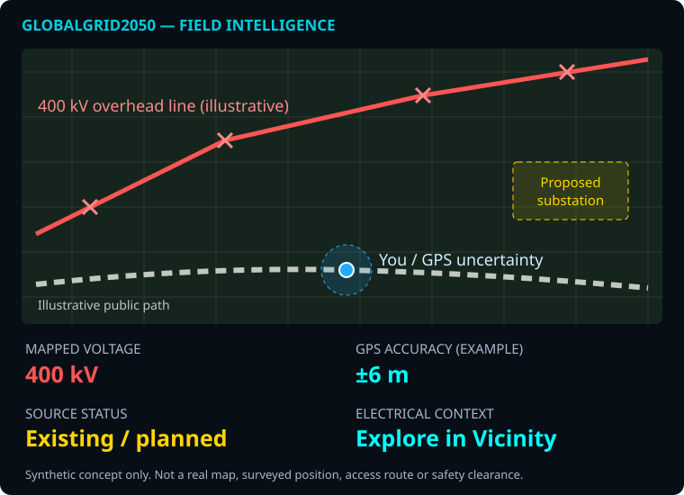
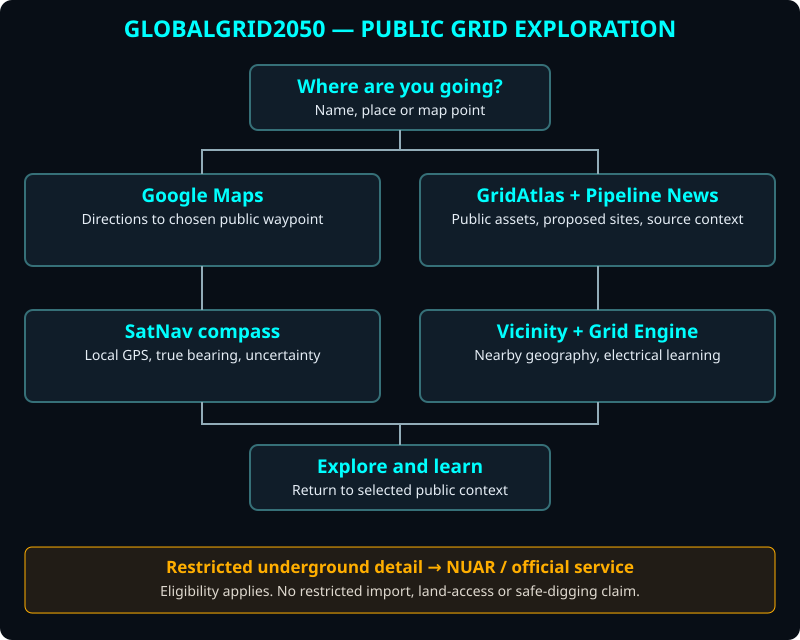
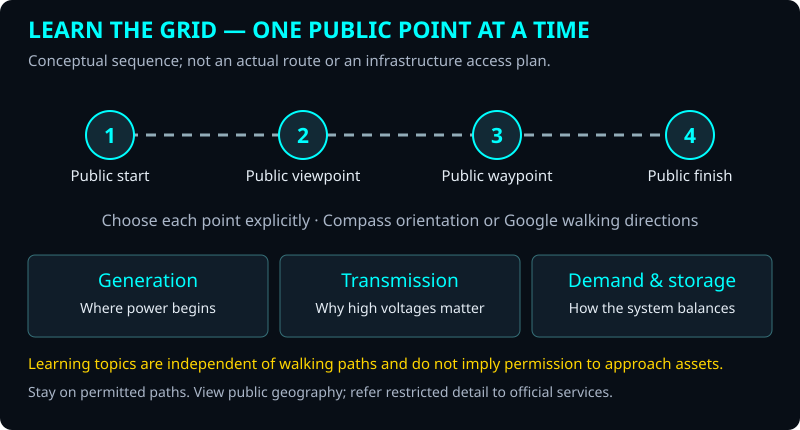

# SatNav — Public electrical navigation, learning and grid exploration

Owner-directed scope extension, 24 November 2026. Companion to Revision 3 and NL-084. Agent 33 sole implementation lead; Agent 31 independent QA and coordination, with their existing scratch helpers. Both MSI terminals may use local-first Git handoff. No additional product writers or production release approval.

## 1. Purpose

Help ALL people participate in the energy transition by making the electricity grid understandable, visible and explorable. Enable the public to appreciate the wonders of the power grid — the largest machine ever made — through geography, engineering knowledge and responsible field orientation. A coordinate compass alone is not the distinctive value: ordinary navigation is already well served by Google Maps. Our added value is electrical context and the connection between publicly available infrastructure information, the physical landscape and energy-system learning. Design for curious citizens, students, landowners, planners, developers and engineers alike. Use plain language, British English, accessible controls and the existing SCADA visual identity.

## 2. Hybrid use of existing applications

- Google Maps: ordinary road and walking directions to user-selected publicly accessible destinations or observation points, via explicit external Maps URL handoff. Use documented cross-platform Maps URLs (api=1). Do not recreate its routing engine, scrape data, embed unlicensed imagery or imply partnership. Omit the current device location from handoff URLs; Google handles its own permissions. If an infrastructure location's access is unknown, offer map viewing or a separately selected public arrival point rather than treating the asset as a routable entrance. Preserve local selected context for return to GridAtlas/SatNav.
- GridAtlas: existing map and satellite layers, public-source electricity geography, voltage and technology layers, provenance and existing versus planned status. Preserve existing appropriate public map detail; do not classify ordinary public grid geography as sensitive merely because it concerns electricity.
- Pipeline News: public planning/project context and exact located source records. Distinguish known, proposed and unmapped points.
- Vicinity: nearby infrastructure analysis, existing 90-point cards, 5/10/20 km rings and CSV. Geographic proximity is not an electrical connection or available capacity.
- SatNav: opt-in local GPS compass, true bearing, straight-line distance and reported accuracy. Separate actual position from mapped reference locations and distinguish compass direction from external walking directions.
- Ventus Grid Engine: existing analytical context and reusable geodesy, not a new routing engine.

| Function | External navigation | GlobalGrid2050 contribution |
| --- | --- | --- |
| Road and walking directions | Google Maps | Link to existing directions; retain electrical context |
| Satellite and map orientation | Google Maps / existing GridAtlas imagery | Public electricity geography and status |
| Infrastructure identification | General place search | GridAtlas voltage, technology and source records |
| Planned projects | General mapping | Pipeline News public planning information |
| Nearby infrastructure | General surroundings | Vicinity analysis and interpretation |
| Selected public overhead-line geography | General map | Orientation and learning about transmission |
| Site identification and learning | Place information | Electrical-system context, source dates, uncertainty and explanatory cards |

## 3. User journey and phased development

First finish M1: human-first “Where are you going?”, named substations, mapped planned projects, place/street/postcode when supported, arbitrary satellite pin and optional advanced signed coordinates. Confirm selection; reject unmapped placeholders. Preserve the exact source name and point and distinguish asset reference, public arrival point and observation point. Never invent an entrance.

After M1 acceptance, add explicit “View in Google Maps”, “Directions to selected public point”, “Use compass” and “Explore in Vicinity” actions. Users can combine ordinary directions with electrical understanding. Preserve selected context on return. Test app-installed and browser fallback on iPhone and Android; avoid automatic sharing of device position.

Add a local ordered list of user-selected public waypoints for a learning walk: choose, reorder, skip, clear and explicitly advance to the next point. Use the compass for orientation or Google Maps for walking directions to the selected public waypoint. Show straight-line and external route distance as distinct concepts. No automatic route generated along an infrastructure asset or through restricted land. Observe public overhead lines from lawful public paths; the mapped line itself is not a footpath. Keep saved waypoints opt-in and local; no walking history by default.

Develop M2 as public electrical orientation. Retain the established selected-section geometry contract and public map context; clearly separate the GPS fix, uncertainty and illustrative reference geometry. Enable people to trace and understand the mapped geography of visible overhead lines, compare voltage classes and see the role of pylons, substations, transformers, AC/DC, generation, storage, distribution and demand. Any field orientation must be from permitted public locations; never direct people onto private or operational land or interpret proximity as a safety clearance. No security/access-point intelligence or operational vulnerabilities. Use abstract diagrams and approved public-source data for demonstrations, with source/revision and limitations. Preserve public planning corridors for future cable schemes where the originating planning source expressly permits that detail to be republished; label proposals and uncertainty. Do not infer, reconstruct or expose restricted buried cable detail. Refer users needing that detail to NUAR or the relevant official service.

Extend site identification and grid literacy with public project name, status, technology, published capacity with units/date, geographic context and accessible explainers: where electricity comes from, how it moves, how storage works and why reinforcement matters. Explain the limits of map analysis. Missing data remains unknown. Public availability, licence, intended reuse, sensitivity and accuracy are checked for each new layer; no blanket removal of existing legitimately public GridAtlas information.

## 4. Restricted detail and safe public use

NUAR is an external secure service, not an open map layer or a public access-permission system. Its official site describes access for eligible asset owners and their authorised supply-chain contractors in England, Wales and Northern Ireland. Users requiring restricted underground asset detail should visit https://www.nuar.uk/ and check eligibility; elsewhere use the appropriate official service/network operator. No login handling, restricted imports, scraping, caching, credentials or hidden-alignment reconstruction. NUAR access does not confer land access or permission to carry out work. Public UI: “For restricted underground asset detail, use NUAR if eligible. This map is not a utility search or safe-digging service.” Consult official safety guidance for work near electrical infrastructure. Public exploration is observational; respect signs, closures, fences and public rights of way, and never enter operational sites, climb pylons, touch equipment or excavate. No electrical clearance, live status, survey or engineering suitability claim from a map, GPS or compass. No private GPS traces or restricted records in GitHub or external handoff URLs.

## 5. Diagrams and design intent

These are editable SVG design references, not real maps, routes, live measurements or permissions. They preserve the earlier field-intelligence concept and extend it to public education, hybrid navigation and user-selected public waypoints. The illustrated numbers are synthetic display examples only, not safety distances. Keep the existing SCADA colour family.

## 6. Acceptance and delivery

Current native M1 PR110 remains the immediate priority. Runtime 6a95a7905264adf20f2862112bb2416af60a3e3a was independently tested locally. Diagnostic-only successor 6bcc7ed4b7273d958953363f7aaf145eed5a2ab2 passed hosted native Chromium (run 45493065978, job 138796373116), but the prior intermittent landscape tap failures remain open evidence because runtime bytes were unchanged. Agent 33 continue existing resolution and CI; Agent 31 independently verify and recommend acceptance. Do not add new features to the candidate under test or delay the first usable iPhone test link. Owner retains approval of isolated HTTPS phone test and production publication.

After M1 acceptance, Agent 33 implements bounded increments: hybrid external handoff and return; public educational Vicinity context; local public-waypoint sequence; then public line/corridor orientation and learning within M2 evidence limits. Agent 31 independently tests each exact pin: valid/invalid destination, URL encoding/no GPS disclosure, return state, waypoint order/skip/cancel, explicit choice and permission boundaries, poor/stale fixes, public-versus-restricted labelling, source/rights, and preservation of MAP/A4/PDF/Layers/Vicinity/CSV/rings and immutable releases. Use synthetic geometry for regressions and cleared public information for demonstrations. No physical device acceptance without actual device tests. Separate local and hosted receipts; retain historical failures. No production pointer, release, catalogue or scheduled workflow edits from this scope-only commit.

## 7. References checked 24 November 2026

- Google Maps URLs documentation: https://developers.google.com/maps/documentation/urls/get-started
- Official NUAR service and eligibility: https://www.nuar.uk/
- GOV.UK NUAR guidance: https://www.gov.uk/guidance/national-underground-asset-register-nuar
- Revision 3 owner directive: https://github.com/Ventusltd/neural-link-between-agents/issues/84#issuecomment-7144824153
- Local-first handoff: https://github.com/Ventusltd/neural-link-between-agents/issues/84#issuecomment-7145087154
- Latest hosted M1 evidence: https://github.com/Ventusltd/neural-link-between-agents/issues/84#issuecomment-7145253928
